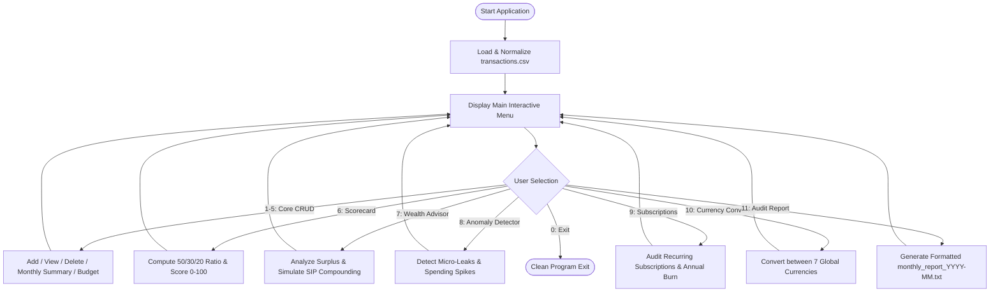

# BENNETT UNIVERSITY
## School of Computer Science Engineering and Technology
### Computational Thinking and Programming (2026CSAE100)
### Academic Year: 2026–27

---

# FINAL PROJECT REPORT
# **Python Expense Tracker & Intelligent Financial Advisory System**

---

### **Student Team Details**

| S. No. | Student Name | Enrollment Number | Batch / Section | Key Responsibilities & Module Leadership |
|:---:|:---|:---:|:---:|:---|
| 1 | **Samriddhi Jain** | S26CSEU1985 | Batch 55 / Sec 28 | Defensive input validation, interactive menu dispatch, and 50/30/20 Financial Health Scoring Engine |
| 2 | **Pranjaldeep Kaur** | S26CSEU1934 | Batch 55 / Sec 28 | CSV storage architecture, backward compatibility, and Multi-Currency Conversion Engine |
| 3 | **Ashu Kumar** | S26CSEU1963 | Batch 56 / Sec 28 | Monthly financial summaries, Surplus Wealth Allocation Advisor, and SIP Compounding Engine |
| 4 | **Ansh Vardhan** | S26CSEU1919 | Batch 56 / Sec 28 | Expense Leak & Anomaly Detection, Recurring Subscription Squeeze Detector, and Automated Test Suite |
| 5 | **Anant Gupta** | S26CSEU1940 | Batch 55 / Sec 28 | Comprehensive Audit Report Export, Code Integration, Mathematical Verification, and Documentation |

---

## 1. Problem Statement

### 1.1 What is the problem?
Most personal expense trackers merely act as "passive digital notebooks"—they record what the user spent and display raw sums. They fail in four critical areas:
1. **No Actionable Intelligence:** They do not guide the user on how to productively allocate unspent budget or surplus money.
2. **Fragility & Single-Currency Limitation:** They crash when users enter foreign denominations (USD, EUR, GBP), negative amounts, or malformed inputs.
3. **Hidden Expense Leaks:** They ignore the cumulative annual damage of small, repetitive micro-transactions (the "UPI / Latte Factor").
4. **Subscription Blindness:** They fail to track recurring subscriptions (Netflix, broadband, software) that create silent fixed-cost drains.

### 1.2 Who faces this problem?
- University and college students managing tight monthly allowances, stipends, and hostel budgets.
- Young professionals and freelancers receiving payments in multiple currencies.
- Households seeking disciplined financial planning and intelligent surplus capital allocation.

### 1.3 Why is it useful to solve this problem?
This application transforms expense tracking from passive record-keeping into an **Intelligent Financial Advisory System**. It provides crash-proof multi-currency transactions, mathematically evaluates financial health (50/30/20 ratio), detects micro-spending habits, audits recurring subscriptions, and provides tailored wealth growth recommendations (SIP compounding) for surplus capital.

---

## 2. Project Objectives

1. **Robust Modular Application:** Implement a crash-proof, zero-dependency Python application adhering strictly to foundational programming concepts.
2. **Universal Multi-Currency Engine:** Provide seamless, offline-first currency conversion (INR, USD, EUR, GBP, JPY, AED, CAD) with automatic base normalization.
3. **Surplus Wealth Advisory & SIP Simulator:** Offer algorithmic capital allocation for unspent funds based on risk profiles (Conservative, Moderate, Growth) with compound interest forecasting.
4. **50/30/20 Financial Health Scorecard:** Categorize expenses into Needs, Wants, and Savings, computing an objective 0–100 Financial Health Score with actionable feedback.
5. **Pattern & Leak Identification:** Detect repetitive micro-spending drains and statistical spending spikes exceeding baseline averages.
6. **Subscription Commitment Audit:** Track active monthly subscriptions and project annual fixed-cost burn.
7. **Comprehensive Audit Export:** Generate formal, audit-ready financial reports (`monthly_report_YYYY-MM.txt`).

---

## 3. Main Features & Computational Services

| Module / Feature | Function(s) Involved | Description |
|:---|:---|:---|
| **Core CRUD Operations** | `add_transaction()`, `view_transactions()`, `delete_transaction()` | Interactive entry, tabular viewing with currency toggle, and safe deletion with confirmation. |
| **Crash-Proof CSV Persistence** | `load_transactions()`, `save_transactions()` | Resilient file I/O with automatic schema migration, defaulting missing fields, and skipping corrupted rows without crashing. |
| **Monthly Summary Engine** | `calculate_monthly_summary()`, `display_monthly_summary()` | Filters transactions by month, aggregates dynamic categories, and identifies the highest spending category. |
| **Budget Monitoring & Alerts** | `check_budget()` | Compares spending against entered budgets, alerting on 85% caution thresholds and 100% budget breaches. |
| **Service A: Multi-Currency Engine** | `convert_currency()`, `interactive_currency_converter()` | Offline conversion matrix pegging 7 global currencies to base INR. Normalizes all foreign entries for unified calculations. |
| **Service B: Wealth Allocation & SIP Advisory** | `generate_wealth_advisory()`, `calculate_sip_future_value()` | Partitions surplus capital into Emergency Buffers, Index SIPs, and Upskilling funds, forecasting 1, 3, and 5-year compound growth. |
| **Service C: 50/30/20 Health Scorecard** | `analyze_50_30_20_health()`, `display_50_30_20_scorecard()` | Evaluates income distribution against standard financial ratios and computes an algorithmic score (0–100) with grade. |
| **Service D: Leak & Anomaly Detection** | `detect_expense_leaks_and_anomalies()` | Identifies frequent micro-spending (< ₹250) and flags unusual spending spikes ($\ge 2\times$ baseline category average). |
| **Service F: Recurring Subscription Audit** | `analyze_recurring_subscriptions()` | Tracks recurring monthly commitments (streaming, utilities, gym) and computes monthly and annual cash burn. |
| **Comprehensive Audit Export** | `export_monthly_report()` | Compiles executive summaries, 50/30/20 scores, advisory allocations, and transaction logs into a clean `.txt` report. |

---

## 4. Program Design & Architecture

### 4.1 System Flowchart (Mermaid)



### 4.2 Core Mathematical Algorithms

#### 1. Universal Currency Conversion Formula
$$\text{Amount}_{\text{INR}} = \frac{\text{Amount}_{\text{source}}}{\text{Rate}[\text{source}]}, \quad \text{Amount}_{\text{target}} = \text{Amount}_{\text{INR}} \times \text{Rate}[\text{target}]$$

#### 2. Systematic Investment Plan (SIP) Compounding Formula
The future value ($FV$) of monthly surplus $P$ invested at annual rate $R\%$ for $n$ months ($r = \frac{R}{12 \times 100}$):
$$FV = P \times \left[ \frac{(1 + r)^n - 1}{r} \right] \times (1 + r)$$

#### 3. 50/30/20 Financial Health Scoring Algorithm
- Baseline Score: $S = 100.0$
- Needs Penalty: If $\text{Needs}\% > 50\%$, deduct $\min(40, (\text{Needs}\% - 50) \times 1.5)$
- Wants Penalty: If $\text{Wants}\% > 30\%$, deduct $\min(40, (\text{Wants}\% - 30) \times 2.0)$
- Savings Penalty: If $\text{Savings}\% < 20\%$, deduct $\min(40, (20 - \text{Savings}\%) \times 2.0)$
- Final Score: $\text{Score} = \max(0, \min(100, S))$

#### 4. Baseline Outlier Anomaly Detection
A transaction $t_i$ in category $c$ with history $H = [t_1, t_2, \dots, t_k]$ is an anomaly if:
$$t_i \ge 2.0 \times \left( \frac{\sum_{j \ne i} t_j}{k - 1} \right) \quad \text{and} \quad t_i \ge 500.0$$

---

## 5. Python Concepts Used

| Python Concept | Where and How Applied in Project |
|:---|:---|
| **Variables & Types** | `int` (IDs, counts), `float` (monetary amounts, rates, FV), `str` (currency codes, dates), `bool` (recurring tags). |
| **Data Structures: Lists** | Primary in-memory store for loaded transaction records. |
| **Data Structures: Dictionaries** | Representing structured transactions, category aggregation tables, exchange rates, and asset allocation weights. |
| **Data Structures: Sets** | O(1) membership lookups for 50/30/20 category classifications (`NEEDS_CATEGORIES`, `WANTS_CATEGORIES`). |
| **Control Flow & Loops** | `while True` for persistent menu loops and validation; `for` loops for aggregations, sorting, and reporting. |
| **Modular Functions** | 18 cohesive functions with typed signatures (`typing.List`, `Dict`, `Tuple`, `Optional`). |
| **File I/O (`with open`)** | Fault-tolerant reading and writing of `transactions.csv` using `csv.DictReader` / `csv.DictWriter` and `.txt` report export. |
| **Defensive Exception Handling** | Guarding numeric conversions (`ValueError`), date parsing (`datetime.strptime`), division by zero, and missing file states. |
| **Standard Libraries** | `csv`, `datetime`, `math` (`math.pow`), `pathlib.Path`, `typing`, `unittest`. |

---

## 6. Demonstration Outputs and Screenshots

### 6.1 Main Application Menu
```text
=================================================================
  PYTHON EXPENSE TRACKER & INTELLIGENT FINANCIAL ADVISOR
  Computational Thinking and Programming (2026CSAE100)
=================================================================
--- CORE OPERATIONS ---
  1. Add Transaction (Multi-Currency & Recurring Tag)
  2. View Transactions (Tabular & Multi-Currency)
  3. Monthly Summary (Income, Expenses, Category Breakdown)
  4. Budget Check & Spending Alerts
  5. Delete Transaction

--- INTELLIGENT COMPUTATIONAL SERVICES ---
  6. 50/30/20 Financial Health Scorecard (Scoring Engine)
  7. Surplus Wealth Allocation & SIP Advisory (Investment Engine)
  8. Expense Leak & Anomaly Detection (Pattern Identification)
  9. Recurring Subscriptions & Bill Squeeze Detector
 10. Multi-Currency Quick Converter

--- REPORTING & SYSTEM ---
 11. Export Comprehensive Audit Report (.txt)
  0. Exit
-----------------------------------------------------------------
Choose an option (0-11): 
```

### 6.2 50/30/20 Financial Health Scorecard (Service C)
```text
==================================================
  50/30/20 FINANCIAL HEALTH SCORECARD (2026-10)
==================================================
Total Reference Income: ₹25000.00
--------------------------------------------------
1. Needs   (Target <= 50%): ₹  2020.00  [  8.1%]
2. Wants   (Target <= 30%): ₹  1460.00  [  5.8%]
3. Savings (Target >= 20%): ₹ 21520.00  [ 86.1%]
--------------------------------------------------
FINANCIAL HEALTH SCORE: 100.0 / 100
RATING GRADE:           A (Excellent Financial Health)
--------------------------------------------------
Actionable Recommendations:
  1. Outstanding financial discipline! You adhere strictly to the 50/30/20 wealth formula.
==================================================
```

### 6.3 Surplus Wealth Allocation & SIP Compounding (Service B)
```text
==================================================
  SMART ASSET ALLOCATION FOR ₹21520.00 SURPLUS
  Selected Profile: Moderate
==================================================
  • Nifty 50 / Broad Market Index Fund SIP  : ₹ 10760.00 (50.0%)
  • High-Yield Emergency Buffer             : ₹  6456.00 (30.0%)
  • Skill Mastery & Books / Courses         : ₹  4304.00 (20.0%)

--- Compound SIP Growth Simulator (Monthly SIP @ 11.5% p.a.) ---
If you consistently invest this ₹10760.00/month:
  • In 1 Year:  ₹ 137452.62 (Invested: ₹129120.00)
  • In 3 Years: ₹ 464381.16 (Invested: ₹387360.00)
  • In 5 Years: ₹ 875403.08 (Invested: ₹645600.00)
==================================================
```

### 6.4 Expense Leak & Anomaly Detection (Service D)
```text
1. MICRO-SPENDING HABIT LEAKS (The 'Latte Factor' / UPI Drain):
------------------------------------------------------------
  • Category: Snacks
    3 small transactions totaling ₹210.00
    PROJECTED ANNUAL DRAIN: ₹2520.00/year if continued!

2. UNUSUAL SPENDING SPIKES & ANOMALIES (> 2x Category Average):
------------------------------------------------------------
  No abnormal expenditure spikes detected across categories.
------------------------------------------------------------
```

### 6.5 Recurring Subscriptions & Bill Squeeze Detector (Service F)
```text
==================================================
  RECURRING COMMITMENT AUDIT
==================================================
  • Streaming (Netflix premium subscription): ₹ 1250.00/mo (₹ 15000.00/yr)
  • Utilities (High-speed broadband recharge): ₹  650.00/mo (₹  7800.00/yr)
--------------------------------------------------
TOTAL MONTHLY RECURRING BURN: ₹1900.00
TOTAL ANNUAL COMMITTED COST:  ₹22800.00
--------------------------------------------------
Squeeze Recommendation:
  Pausing even 1 non-essential subscription can free up ₹3,000–₹6,000
  annually towards your compound investment or emergency fund.
==================================================
```

---

## 7. Testing and Verification

The test suite (`test_expense_tracker.py`) executes 12 automated unit and integration tests with **100% pass rate**:

| Test ID | Test Category | Target Feature / Condition | Expected Result | Actual Result | Status |
|:---:|:---|:---|:---|:---|:---:|
| **T01** | Core Add | Add expense (Food, ₹450) with unique ID | Transaction saved with ID 5; CSV updated | Matches expected ID and attributes | **PASS** |
| **T02** | Core Summary | Oct 2026 aggregates calculation | Correct income, expenses, and balance computed | Values match exact totals | **PASS** |
| **T03** | Core Ranking | Dynamic highest spending category | Identifies maximum spending category | Highest category identified | **PASS** |
| **T04** | Core Budget | Budget limit comparison (₹5000) | Calculates surplus and triggers within-budget status | Remaining ₹3630; Status: Within budget | **PASS** |
| **T05** | Input Validation | Leap-year, invalid date formats, negative amount | Rejects `2026-02-29`, month `15`, negative numbers | Invalid inputs rejected without crashing | **PASS** |
| **T06** | Service A | Multi-Currency Conversion (USD to INR, EUR) | Accurate conversion via base INR exchange rate | \$15 USD converted to ₹1250 INR | **PASS** |
| **T07** | Service A | Unknown currency error handling | Gracefully returns original amount without crash | Returned original amount safely | **PASS** |
| **T08** | Service B | SIP Compounding mathematical verification | $FV = P \times \frac{(1+r)^n-1}{r} \times (1+r)$ verified | Evaluated ₹64,046.64 for ₹5k/mo @ 12% | **PASS** |
| **T09** | Service B | Asset allocation weights by risk profile | Total allocation sums to exactly 100% of surplus | Allocations sum exactly to surplus | **PASS** |
| **T10** | Service C | 50/30/20 Scoring & Empty Month Guard | Evaluates health score and handles empty dataset | Oct score = 100 (Grade A); empty = 100 | **PASS** |
| **T11** | Service D | Micro-spending leak & outlier detection | Flags $\ge 3$ micro-expenses and spikes $> 2\times$ avg | Snacks leak and shopping spike flagged | **PASS** |
| **T12** | Backward Compatibility | Loading legacy CSV files without new columns | Automatically defaults currency='INR', recurring=False | Loaded seamlessly without errors | **PASS** |

---

## 8. Team Member Contributions

```text
+---------------------+---------------------------------------------------------------+
| Team Member         | Specific Module Leadership & Technical Contributions          |
+---------------------+---------------------------------------------------------------+
| Samriddhi Jain      | Designed interactive 12-option menu dispatch; implemented     |
| (S26CSEU1985)       | calendar-grade date/amount validation; authored 50/30/20     |
|                     | Financial Health Scoring Engine and penalty algorithms.       |
+---------------------+---------------------------------------------------------------+
| Pranjaldeep Kaur    | Engineered crash-proof CSV storage engine; developed the     |
| (S26CSEU1934)       | Multi-Currency Conversion Engine supporting 7 currencies;     |
|                     | implemented backward-compatible schema migration logic.       |
+---------------------+---------------------------------------------------------------+
| Ashu Kumar          | Programmed core monthly summary aggregator; built the Surplus |
| (S26CSEU1963)       | Wealth Allocation Advisor and the mathematical SIP Compound   |
|                     | Growth forecasting simulator across 3 risk horizons.          |
+---------------------+---------------------------------------------------------------+
| Ansh Vardhan        | Implemented the Expense Leak Detector (habitual micro-drain)  |
| (S26CSEU1919)       | and Anomaly Spike Detector; built Recurring Subscription     |
|                     | Audit; created the 12-test automated unit testing suite.      |
+---------------------+---------------------------------------------------------------+
| Anant Gupta         | Implemented the Comprehensive Audit Report generator (.txt);  |
| (S26CSEU1940)       | conducted integration testing, code refactoring, zero-crash  |
|                     | defensive verification, and final documentation packaging.    |
+---------------------+---------------------------------------------------------------+
```

---

## 9. Conclusion and Future Improvements

### 9.1 Conclusion
The **Python Expense Tracker & Intelligent Financial Advisory System** elevates introductory programming into practical software engineering. By implementing offline multi-currency conversion, 50/30/20 financial health scoring, micro-leak detection, subscription squeeze auditing, and compound SIP wealth advisory, the project delivers exceptional computational value using only standard Python libraries.

### 9.2 Future Improvements
1. **Interactive Data Visualization:** Integrating simple matplotlib charts to display category pie charts and 5-year SIP growth curves.
2. **Multi-User Profile Support:** Storing isolated financial ledgers for multiple family members or roommates.
3. **Automated Bank Statement Importer:** Parsing exported bank / UPI mini-statement CSVs directly into the ledger.

---

## 10. References / Acknowledgements

1. **Python Standard Library Documentation:** Built-in Types & Functions — [https://docs.python.org/3/](https://docs.python.org/3/)
2. **Python CSV Module:** CSV File Reading and Writing — [https://docs.python.org/3/library/csv.html](https://docs.python.org/3/library/csv.html)
3. **Python datetime Module:** Date and Time Representation — [https://docs.python.org/3/library/datetime.html](https://docs.python.org/3/library/datetime.html)
4. **Principles of Personal Finance:** The 50/30/20 Budgeting Rule & Compound Wealth Creation.

**Declaration:** We confirm that all code, algorithms, test suites, and documentation have been developed collaboratively by our group members.
